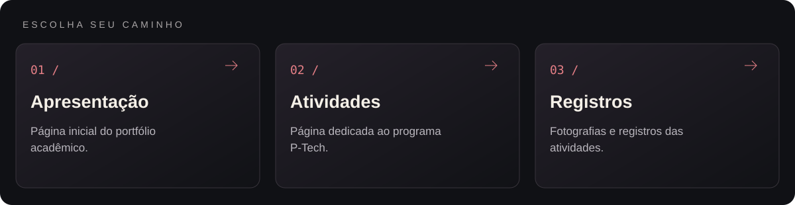
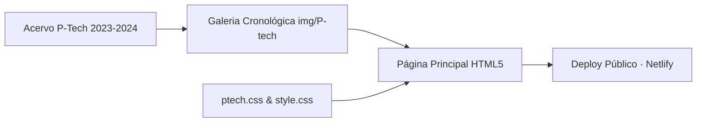

<p align="center">
  
</p>

<p align="center">Registro da trajetória acadêmica, palestras e atividades do programa P-Tech.</p>

<p align="center"></p>

<p align="center"><a href="#visão-geral">Visão geral</a> &nbsp;·&nbsp; <a href="#recursos">Recursos</a> &nbsp;·&nbsp; <a href="#como-executar">Como executar</a></p>

---

<a id="explore-o-projeto"></a>




<table width="100%">
<tr><th align="left">Área</th><th align="left">O que você encontra</th><th align="left">Acesso direto</th></tr>
<tr><td><strong>Apresentação</strong></td><td>Página inicial do portfólio acadêmico.</td><td><a href="Portfolio-PTECH-main/index.html">Abrir apresentação →</a></td></tr>
<tr><td><strong>Atividades</strong></td><td>Página dedicada ao programa P-Tech.</td><td><a href="Portfolio-PTECH-main/ptech.html">Abrir atividades →</a></td></tr>
<tr><td><strong>Registros</strong></td><td>Fotografias e registros das atividades.</td><td><a href="Portfolio-PTECH-main/img/P-tech">Abrir registros →</a></td></tr>
</table>

<a id="visão-geral"></a>


A interface combina folhas de estilo dedicadas (ptech.css e style.css), galeria organizada por datas de eventos (img/P-tech/) e versão publicada na nuvem via **Netlify**.

<a id="recursos"></a>


| Recurso | Como funciona |
|---|---|
| Linha do tempo de eventos | Registro visual e descritivo dos encontros técnicos com empresas parceiras (Tegra, Eduzz, etc.) de abril/2023 a setembro/2024. |
| Galeria cronológica (img/P-tech) | Acervo fotográfico e certificados organizados em subpastas datadas do (1) ao (11). |
| Estilização modular | Separação entre estilos estruturais (style.css) e componentes específicos da vitrine P-Tech (ptech.css). |
| Hospedagem contínua | Publicação acessível online em [ptecharthur.netlify.app](https://ptecharthur.netlify.app/). |

<details>
<summary>Arquitetura</summary>



</details>

<details>
<summary>Estrutura do repositório</summary>

```text
Ptech/
├── assets/
│   └── banner-v2.png               Banner do projeto
├── Portfolio-PTECH-main/
│   ├── css/                                Folhas de estilo ptech.css e style.css
│   ├── img/P-tech/                         Registros dos 11 encontros e workshops (2023–2024)
│   ├── index.html                          Página principal do portfólio P-Tech
│   └── README.md
└── README.md
```

</details>

<a id="como-executar"></a>


1. Acesse a versão online em **[ptecharthur.netlify.app](https://ptecharthur.netlify.app/)** ou clone o repositório:
   ```bash
   git clone https://github.com/arthurlynow098/Ptech.git
   ```
2. Abra Portfolio-PTECH-main/index.html diretamente no navegador.

---

<p align="center">
  <a href="https://github.com/arthurlynow098">GitHub</a> &nbsp;·&nbsp;
  <a href="https://arthurentsev.vercel.app/">Portfólio</a> &nbsp;·&nbsp;
  <a href="https://www.linkedin.com/in/entsevarthur/">LinkedIn</a>
</p>
