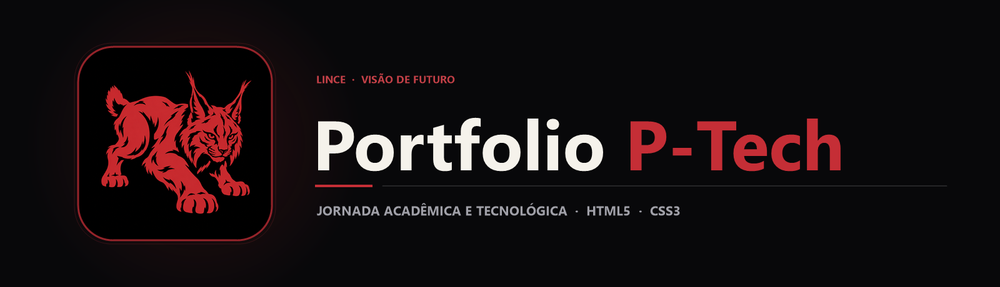

  

  Portfólio web documentando a jornada acadêmica, palestras corporativas e imersões tecnológicas realizadas no programa P-Tech (2023–2024).

  
  
  

## Sobre o projeto

O programa **P-Tech (Pathways in Technology Early College High School)** aproxima estudantes de tecnologia do ecossistema real de empresas parceiras como **Tegra** e **Eduzz** na Fatec/Etec Fernando Prestes. Este repositório armazena o portfólio web desenvolvido para registrar cronologicamente mais de 11 encontros técnicos, mentorias e certificações realizadas entre 2023 e 2024.

A interface combina folhas de estilo dedicadas (ptech.css e style.css), galeria organizada por datas de eventos (img/P-tech/) e versão publicada na nuvem via **Netlify**.

## Principais recursos

| Recurso | Como funciona |
|---|---|
| Linha do tempo de eventos | Registro visual e descritivo dos encontros técnicos com empresas parceiras (Tegra, Eduzz, etc.) de abril/2023 a setembro/2024. |
| Galeria cronológica (img/P-tech) | Acervo fotográfico e certificados organizados em subpastas datadas do (1) ao (11). |
| Estilização modular | Separação entre estilos estruturais (style.css) e componentes específicos da vitrine P-Tech (ptech.css). |
| Hospedagem contínua | Publicação acessível online em [ptecharthur.netlify.app](https://ptecharthur.netlify.app/). |

## Tecnologias

  
  
  

## Arquitetura

`mermaid
flowchart LR
    A[Acervo P-Tech 2023-2024] --> B[Galeria Cronológica img/P-tech]
    B --> C[Página Principal HTML5]
    D[ptech.css & style.css] --> C
    C --> E[Deploy Público · Netlify]
`

## Estrutura do repositório

`	ext
Ptech/
├── assets/
│   ├── banner.png                          Banner principal Portfolio P-Tech
│   └── project-animal.png                  Símbolo do lince
├── Portfolio-PTECH-main/
│   ├── css/                                Folhas de estilo ptech.css e style.css
│   ├── img/P-tech/                         Registros dos 11 encontros e workshops (2023–2024)
│   ├── index.html                          Página principal do portfólio P-Tech
│   └── README.md
└── README.md
`

## Executando o código

1. Acesse a versão online em **[ptecharthur.netlify.app](https://ptecharthur.netlify.app/)** ou clone o repositório:
   `ash
   git clone https://github.com/arthurlynow098/Ptech.git
   `
2. Abra Portfolio-PTECH-main/index.html diretamente no navegador.

---

Estudo · construção · evolução <a href="https://github.com/arthurlynow098">Perfil</a> · <a href="https://arthurentsev.vercel.app/">Portfólio</a> · <a href="https://www.linkedin.com/in/entsevarthur/">LinkedIn</a>

